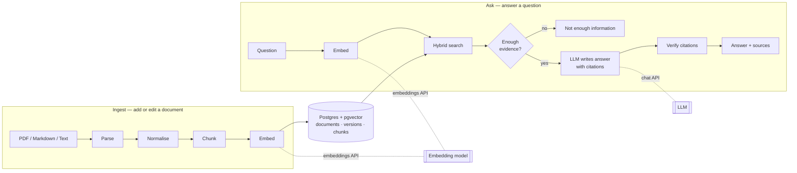
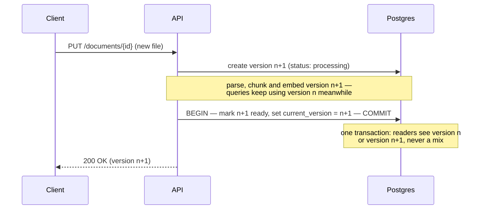

# Architecture

One FastAPI service and one Postgres database (with pgvector). Embeddings come from an OpenAI-compatible
embeddings API; answers are written by an LLM behind an OpenAI-compatible chat API.

## Flow

| Step | What it does |
|---|---|
| Parse | Extract text; keep page numbers (PDF) and headings (Markdown). |
| Normalise | One spelling per character (Arabic ي/ك → Persian ی/ک), half-spaces, digits, strip PDF control characters. |
| Chunk | Split into overlapping pieces; each keeps document, version, section, page and character offsets. |
| Embed | Turn each chunk into a vector with the chosen embedding model. |
| Hybrid search | Vector similarity + keyword match, fused by rank, over **current versions of live documents only**. |
| Evidence check | If the best match is too weak, answer "not enough information" without calling the LLM. |
| Generate | The LLM answers only from numbered sources and cites them as `[n]`. |
| Verify | Every `[n]` must be a source we sent; an answer with no valid citation becomes "not enough information". |

## Editing a document without serving stale or mixed content

Search always filters `document is not deleted AND chunk.version = document.current_version`, so outdated chunks
can never be returned even before they are cleaned up. Deleting a document is a single update that excludes it from
every later search.
