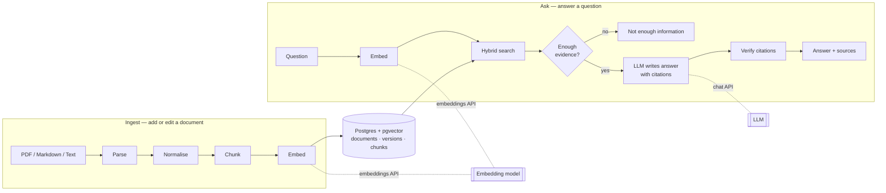

# Architecture

One FastAPI service and one Postgres database (with pgvector). Embeddings come from an OpenAI-compatible
embeddings API; answers are written by an LLM behind an OpenAI-compatible chat API.

## Flow



| Step | What it does |
|---|---|
| Parse | Extract text; keep page numbers (PDF) and headings (Markdown). |
| Normalise | One spelling per character (Arabic ي/ك → Persian ی/ک), digits, half-spaces kept, invisible and control characters removed. |
| Chunk | Split into overlapping pieces of up to 1,200 characters; each keeps its document, version, section (Markdown) or page (PDF). |
| Embed | Turn each chunk into a vector with the chosen embedding model. |
| Hybrid search | Vector similarity + keyword match (all words must match), fused by rank (RRF), over **current versions only**. |
| Evidence check | If the best match is too weak, answer "not enough information" without calling the LLM. |
| Generate | The LLM answers only from numbered sources and cites them as `[n]`. |
| Verify | Every `[n]` must be a source we sent; an answer with no valid citation becomes "not enough information". |

## Editing a document without serving stale or mixed content

```mermaid
sequenceDiagram
    participant C as Client
    participant API
    participant DB as Postgres
    C->>API: PUT /documents/{id} (new file, If-Match: n)
    API->>DB: read the document (version n)
    Note over API: If-Match ≠ n → 409 Conflict
    Note over API,DB: parse, chunk and embed the new file, outside any transaction —<br/>questions keep using version n meanwhile; if embedding fails, nothing changes (503)
    API->>DB: BEGIN
    API->>DB: UPDATE documents SET version = n+1 WHERE id = … AND version = n
    Note over DB: 0 rows updated → someone else changed it → ROLLBACK, 409 Conflict
    API->>DB: INSERT the chunks of version n+1
    API->>DB: DELETE this document's chunks of other versions
    API->>DB: COMMIT
    Note over DB: one transaction: readers see version n or version n+1, never a mix
    API-->>C: 200 OK (version n+1)
```

Each search joins `chunks.version = documents.version` inside the query, so chunks of an older version can never be
returned, even if they were somehow not deleted (a test plants one to prove it). Deleting a document is one `DELETE`;
its chunks go with it in the same transaction (`ON DELETE CASCADE`), so it is excluded from the next question on.

## Code map

| Module | Responsibility |
|---|---|
| `ingest.py` | File → normalised chunks with section or page (no database, no network) |
| `embeddings.py` | Text → vectors through any OpenAI-compatible embeddings API, batched, with retries |
| `documents.py` | Create, replace and delete documents; the one-transaction version switch |
| `retrieval.py` | Hybrid search SQL (vector + keyword, current versions only) and rank fusion |
| `answering.py` | Evidence gate, prompt, LLM call, citation check |
| `api.py`, `main.py` | HTTP endpoints, request validation, domain errors → HTTP status codes |
| `config.py`, `db.py`, `models.py` | Settings from the environment, database session, tables |
